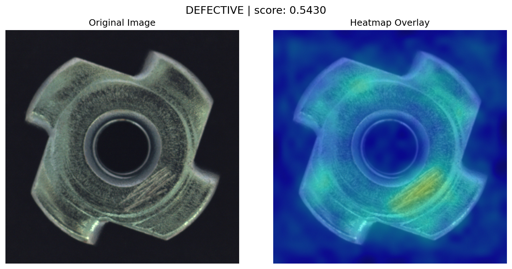

# Industrial Defect Detection

Unsupervised visual defect detection for manufactured parts, built with [Anomalib](https://github.com/open-edge-platform/anomalib) and PyTorch.
A **PatchCore** model learns what good parts look like from defect-free images only. At inference time it scores each image and produces a heatmap that localizes the defect.



## Results: MVTec AD `metal_nut`

| Metric | Value |
|---|---|
| Image AUROC (Colab test run) | 0.998 |
| Image AUROC (exported model, re-evaluated locally) | 0.994 |
| Correct at the default threshold (0.5) | 110 / 115 test images |
| Defects caught | 92 / 93 |
| Good parts falsely flagged | 4 / 22 |
| CPU inference time (6 threads, no GPU) | ~0.9 s per image |

These numbers come from the first training run, which used Anomalib's default validation split. That split tunes the decision threshold on the test images themselves. `train.py` now defaults to `--val-split from_test`, which tunes on one half of the test set and reports on the other half.

## Project structure

```
train.py                     Train PatchCore locally or on Colab -> models/<category>/
inference.py                 Score images, save original-vs-heatmap comparisons
dataset_zip.py               Zip data/mvtec into data.zip for uploading to Colab
notebooks/train_colab.ipynb  One-click Colab training
requirements.txt
```

Not in the repo (see `.gitignore`): `data/`, `models/`, `results/`, `output_inference/`, `*.zip`.

## Setup

```bash
git clone https://github.com/Rafey28/defect-detection.git
cd defect-detection
pip install -r requirements.txt
```

## Dataset

Download [MVTec AD](https://www.mvtec.com/company/research/datasets/mvtec-ad) (free for non-commercial use) and place the categories you want here:

```
data/mvtec/metal_nut/{train,test,ground_truth}
```

To train on Colab, run `python dataset_zip.py` to create `data.zip`.

## Training

Both options produce the same bundle, `models/<category>/model.pt` plus `metadata.json` (settings and test metrics).

### Option A: Google Colab (recommended)

Training needs about 5–6 GB of RAM at its peak and is slow on a CPU. A free Colab GPU avoids both problems.

1. Upload `data.zip` to `MyDrive/industrial_defect_detection/` in Google Drive.
2. Open [`notebooks/train_colab.ipynb`](notebooks/train_colab.ipynb) in Colab, choose a GPU runtime, and run all cells.
3. Download `<category>_model.zip` from `MyDrive/industrial_defect_detection/models/` (or from the notebook's last cell) into the project root.

`inference.py` extracts the zip into `models/` the first time it runs.

### Option B: Local

```bash
python train.py --category metal_nut
```

Useful options: `--data-root`, `--batch-size`, `--seed`, `--skip-test`. Run `python train.py --help` for the full list.

## Inference

```bash
# One image
python inference.py --category metal_nut --trust-model --image ./data/mvtec/metal_nut/test/scratch/000.png

# A whole folder
python inference.py --category metal_nut --trust-model --image ./data/mvtec/metal_nut/test/scratch
```

Each image prints a verdict, for example `DEFECTIVE (anomaly score: 0.5430)`. A side-by-side comparison is saved to `output_inference/`.

`--trust-model` is required because Anomalib's `.pt` export is a pickle file, which can run code when loaded. Use it only with models you trained yourself. Models trained on Colab (Linux) load on Windows without extra steps.

## Roadmap

- [x] **Milestone 1:** PatchCore training (local and Colab), exported model, inference with heatmaps
- [ ] **Milestone 2:** CoppeliaSim integration over the ZMQ Remote API. A simulated conveyor and vision sensor stream frames to the detector, and defective parts are rejected automatically.
